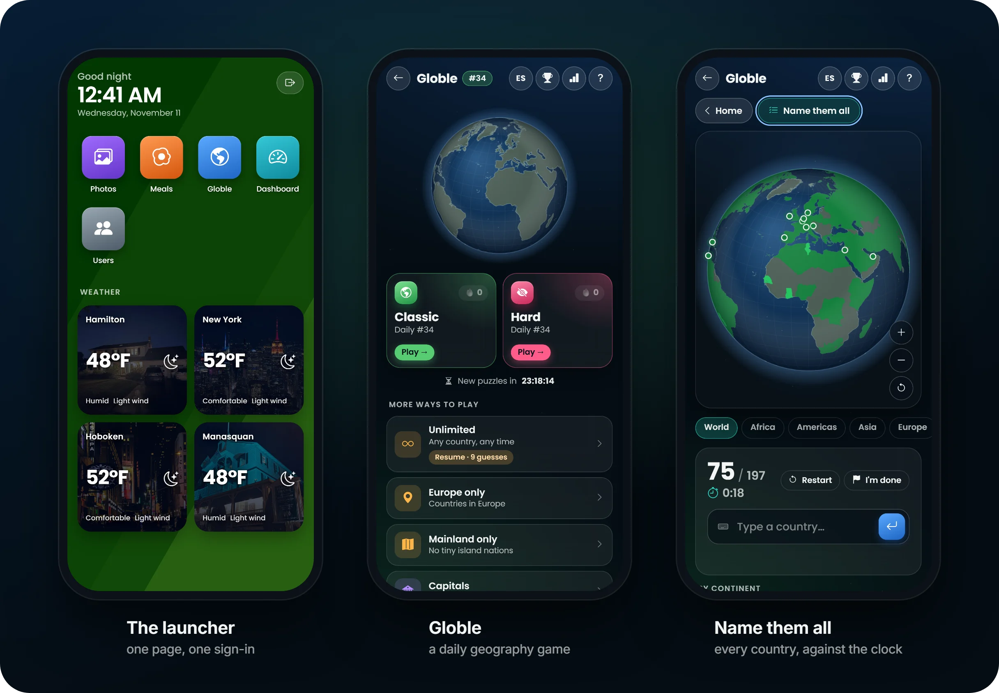
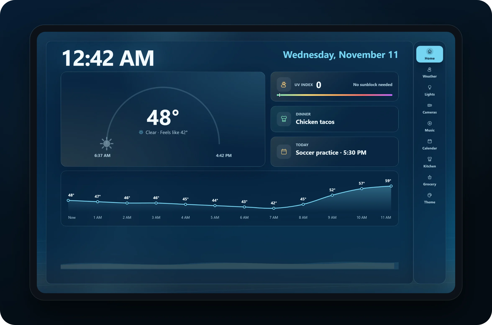
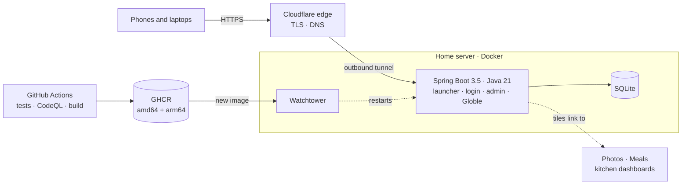

  

<h1 align="center">Gehan Cloud</h1>

  <b>The self-hosted platform my family uses every day.</b> 
  One sign-in for our photos, our meals, a daily geography game and the kitchen dashboards in two houses.

  <a href="https://gehan.cloud"><b>gehan.cloud</b></a> (family sign-in)
  &nbsp;·&nbsp;
  <a href="docs/media/gehan-cloud-tour.mp4">Watch the 23-second tour</a>
  &nbsp;·&nbsp;
  <a href="https://github.com/rjgehan/Beach-Dashboard">Kitchen dashboard repo</a>

  
  
  
  
  
  

A silent preview. Click it for the narrated version (MP4, 23 seconds).

## At a glance

| | |
| --- | --- |
| **In production** | Live at gehan.cloud for almost a year and a half, self-hosted on hardware I run |
| **Real users** | 7 family accounts. 5 of us play Globle every day |
| **Two houses** | A kitchen tablet in each, running the [companion dashboard](https://github.com/rjgehan/Beach-Dashboard) |
| **Tested** | 379 automated tests on every push and pull request, plus CodeQL and Dependabot |
| **Shipped automatically** | Push to `main` → GitHub Actions → GHCR (amd64 + arm64) → Watchtower restarts it |
| **Nothing exposed** | Cloudflare Tunnel: no open ports, no port forwarding, no public IP |

## Why it exists

I wanted everyone in my family to have access to everything we share, photos included.
Gehan Cloud is that one place: one sign-in for each of us, and a tile for everything the
family uses. It was also the right moment to move the family's photos onto a server I
run, while I still lived at home. It has grown in iterations since, into a daily game
the family plays and a dashboard in the kitchen at both houses.

## What's in it

**The launcher.** A phone-style home screen with one tile per service. The tiles come
from a YAML file and page like a phone's when they fill up, under live weather for the
places the family cares about. A service that only exists on a home network becomes a
link only when you are standing on that network. Photos opens the family photo library,
and Meals opens [Breadbox](https://github.com/rjgehan/Waxwing), the recipe and grocery
app I also built.

**Accounts.** Form login and an admin console. Nobody is handed a temporary password:
the first password typed for a new account becomes its password.

**Globle.** A daily geography game in the spirit of
[globle-game.com](https://globle-game.com): one mystery country a day, the same for
everyone, found by guessing countries and watching them light up hotter or colder on a
spinning globe. There is a Hard daily too, practice by region or by capital city,
leaderboards and streaks, and **Name them all**: name every country you can against the
clock, then study the ones you missed. Everything is in English and Spanish, and names
are accepted in either language whichever one the page is showing.
[More about Globle](docs/globle.md).

**The kitchen dashboard** ([its own repo](https://github.com/rjgehan/Beach-Dashboard)).
A Spring Boot kiosk app on a tablet in the kitchen at both houses: the clock, weather,
tides and rain radar, the family's iCloud calendar, tonight's dinner, the grocery list,
camera snapshots, and lights and ceiling fans switched through Home Assistant.

The screenshots and video come from a local copy with test data. The dinner and
calendar cards show stand-ins, because their integrations are private.

## Engineering highlights

- **One sign-in in front of many services.** `/__auth` and `/__lan` are forward-auth
  probes. A reverse proxy asks whether the visitor is signed in, or on a home network,
  so another service can sit behind this login instead of growing its own.
- **Two houses, one tile.** Each house has a dashboard on its own LAN at a private
  address. The app reads `CF-Connecting-IP`, works out *which* house you are in from
  named networks, and renders that house's URL. Anywhere else the tile has no `href` at
  all, so a private address never reaches a page served outside its network, and a test
  asserts it. [The full story](docs/architecture.md#the-two-houses-problem).
- **No password to hand out.** A custom `AuthenticationProvider` runs ahead of Spring
  Security's `DaoAuthenticationProvider` and turns the first password typed for an
  unclaimed account into its BCrypt hash. Lockout rules (you cannot delete yourself or
  remove the last admin) live in the service layer with unit tests, not in hidden
  buttons.
- **Schema upgrades without a migration tool.** Hibernate's `ddl-auto=update` on
  SQLite means every change must be additive. Upgrade tests boot the app on a database
  file shaped exactly like an earlier release's, and check that the upgrade only adds
  and that every old game still reads as it did.
- **Secure by default.** CSRF on every state change, a `Secure` / `HttpOnly` /
  `SameSite` session cookie rotated on login, a CSP with `script-src 'self'`, HSTS,
  validated redirect targets and a non-root container.
  [Security and known limitations](docs/architecture.md#security).

### Globle under the hood

- **A daily answer nobody can spoil.** In a public repo, a seeded shuffle of the date is
  a spoiler anyone can run. Instead the server draws the day's country with
  `SecureRandom` the first time it is needed, stores it, and reveals it only for
  finished games. A test checks that no in-progress response contains it.
- **Exact distances, precomputed.** "How close" means the gap between borders, so
  neighbours are 0 km. A build tool measures every pair of Natural Earth shapes once,
  on a sphere, and the server ships the 248 × 248 matrix.
- **A spell check that forgives typos but not wrong answers.** "kyrigistan" counts as
  Kyrgyzstan and "Did you mean Nauru?" catches near misses, in English or Spanish.
  Territories, regions and former names never count. Against a corpus of 1,138 realistic
  misspellings, 93.4% count at once and none as the wrong country. A second, independent
  corpus counted none of its 1,005 non-countries.
- **Built to be removed.** The whole game is one package behind `globle.enabled`, with
  its own security filter chain. A test boots the app with the game off and checks that
  the launcher behaves exactly as before.

## Architecture

Nothing listens on the server's public interface. The tunnel is dialled outbound, so
there is no open port to find, and services on other machines are reached over
Tailscale. Every route, the security model and the repository layout are in
[Architecture and security](docs/architecture.md).

## Stack

| | |
| --- | --- |
| **Backend** | Java 21, Spring Boot 3.5 (Web, Security, Data JPA, Thymeleaf) |
| **Data** | SQLite through Hibernate; H2 in tests |
| **Frontend** | Server-rendered Thymeleaf. Globle is plain JavaScript modules on a d3-geo canvas globe, with no framework and no build step |
| **Testing** | JUnit 5, Spring Boot Test, Spring Security Test: 379 tests |
| **CI/CD** | GitHub Actions (build and test, CodeQL, image publish), Dependabot, GHCR, Watchtower |
| **Hosting** | Docker (multi-stage, multi-arch, non-root), Cloudflare Tunnel, Tailscale |

## How it was built

I decide what it does and how it should behave, and I run it: the servers, the
network, the deploys, and the family's feature requests. Most of the code was written
with AI coding agents (Claude Code and OpenAI Codex) working from that direction, with
the test suite and CI as the bar every change has to clear.

## Documentation

| | |
| --- | --- |
| [Architecture and security](docs/architecture.md) | The request path, design notes, every endpoint, the security model, known limitations, repository layout |
| [Running it](docs/running.md) | Build, test, configure, add a tile, manage accounts |
| [Networks and tiles](docs/networking.md) | Forward-auth, `lanOnly`, the two houses, which address the app believes |
| [Deploying](docs/deploying.md) | The image, the server, CasaOS, the Cloudflare side, CI |
| [Globle](docs/globle.md) | The game: modes, name-change requests, languages, how it works, its data, removing it |

## License

[MIT](LICENSE)
